# MisCompras

Planificador de compras del hogar para Android nativo. Permite crear una lista antes de ir al
supermercado, registrar los precios reales durante la compra, aplicar descuentos y analizar el
historial para conocer hábitos, precios y gasto.

La aplicación funciona **completamente offline**: no requiere Internet ni permisos de red.

- **Lenguaje:** Java (sin Kotlin)
- **Arquitectura:** MVVM + Repository Pattern
- **Persistencia:** Room (SQLite)
- **UI:** Material Design 3, RecyclerView, ViewBinding-free (findViewById), tema claro/oscuro
- **Navegación principal:** Bottom Navigation con 5 secciones

## Requisitos

| Elemento | Versión |
| --- | --- |
| Android Gradle Plugin | 9.3.3 |
| Gradle | 9.5.0 |
| JDK | 11 o superior |
| compileSdk / targetSdk | 37 |
| minSdk | 27 (Android 8.1) |

## Primer inicio

La aplicación muestra una breve bienvenida y luego un asistente de tres pasos que explica el
funcionamiento. Al final se elige el **idioma** (español, inglés, portugués) y la **moneda**
(CLP, USD, ARS, PEN, EUR, MXN, COP), que define el símbolo y si los importes llevan decimales.
La preferencia queda guardada y se aplica a todos los montos de la app.

| Bienvenida | Introducción | Idioma y moneda |
| --- | --- | --- |
| 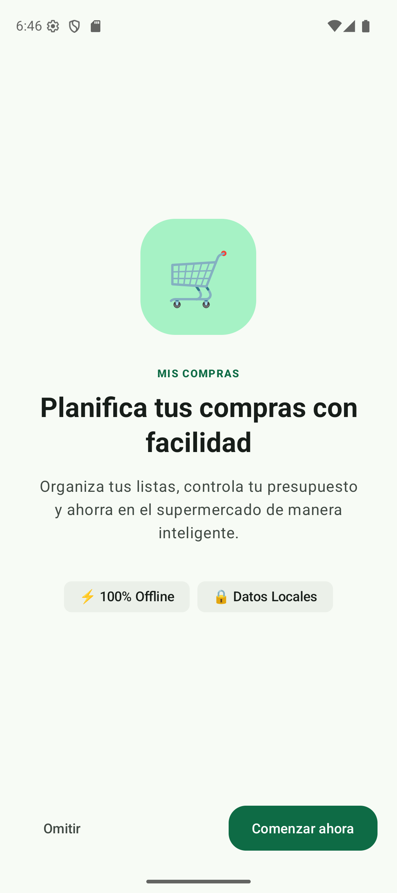 | 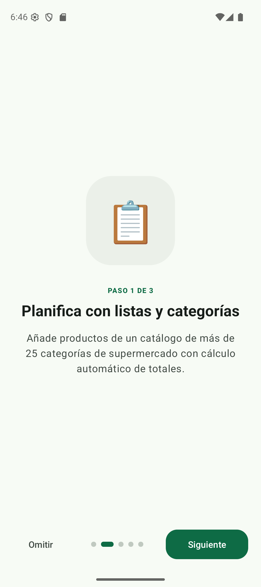 | 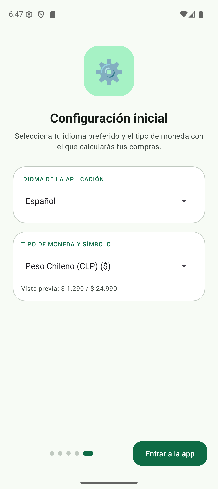 |

> Las capturas son de la versión de depuración ejecutada en el emulador, con los datos de ejemplo
> que se insertan en la primera apertura.

## Cómo compilar y ejecutar

Abrir el proyecto directamente en Android Studio y pulsar *Run*, o desde la línea de comandos:

```bash
# Windows
gradlew.bat :app:assembleDebug

# Linux / macOS
./gradlew assembleDebug
```

El APK de depuración queda en:

```text
app/build/outputs/apk/debug/app-debug.apk
```

Instalación manual en un dispositivo o emulador:

```bash
adb install -r app/build/outputs/apk/debug/app-debug.apk
```

Otros comandos útiles:

```bash
gradlew.bat :app:lintDebug      # análisis estático (Android Lint)
gradlew.bat :app:clean          # limpiar compilación
```

## Funcionalidades

### Inicio (Dashboard)

Compra actual con nombre, fecha, cantidad de productos, total estimado, total real y diferencia
(ahorro o sobrecosto). Accesos rápidos a *Continuar compra*, *Nueva lista*, *Productos*,
*Historial* y *Estadísticas*, además de las últimas compras realizadas.

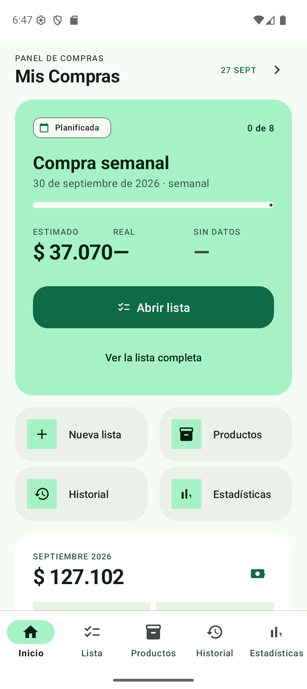

### Listas de compra

- Crear lista con nombre, fecha y periodicidad: semanal, quincenal, mensual u otra.
- Estados: `PLANNED` → `IN_PROGRESS` → `COMPLETED`, y cancelación desde los dos primeros.
- Sugerencias de productos al crear la lista, a partir del inventario y del historial de compras.
  El usuario confirma cuáles agregar; nunca se agregan productos automáticamente.
- Detalle de la lista: editar cantidad, cambiar precio estimado, marcar como comprado, eliminar
  producto, reordenar, editar o cancelar la lista.

| Listas | Nueva lista |
| --- | --- |
| 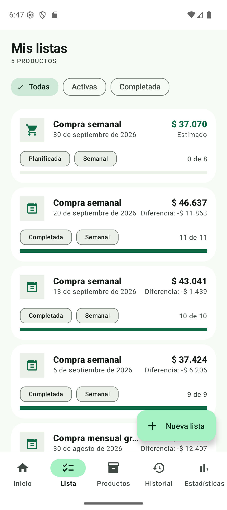 | 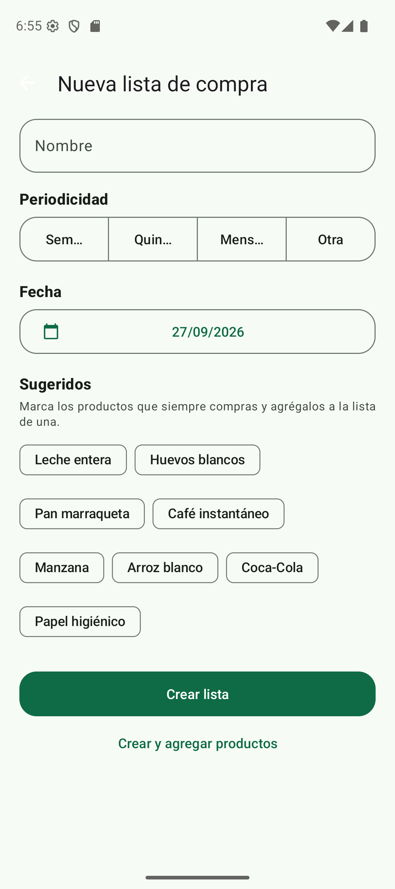 |

Detalle de la lista con el resumen de estimados, real y diferencia:

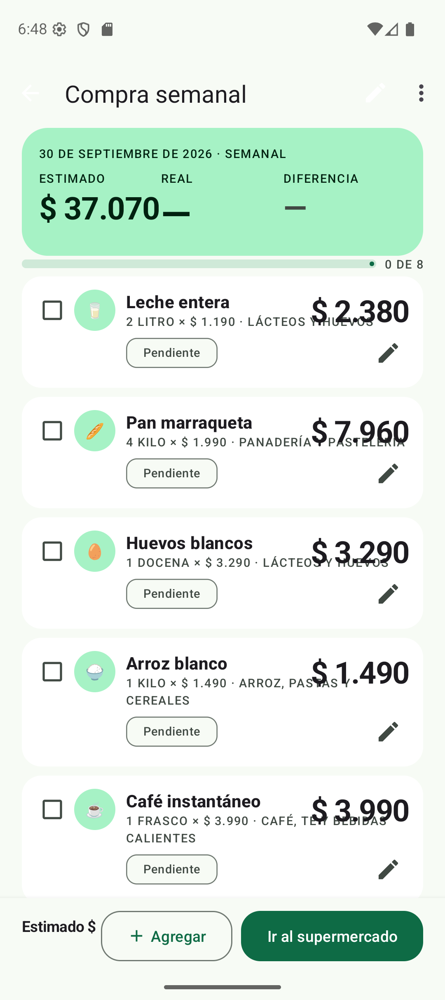

Al agregar productos se puede buscarlos, filtrarlos por categoría y marcarlos en lote; la barra
inferior indica cuántos hay seleccionados y el total a agregar:

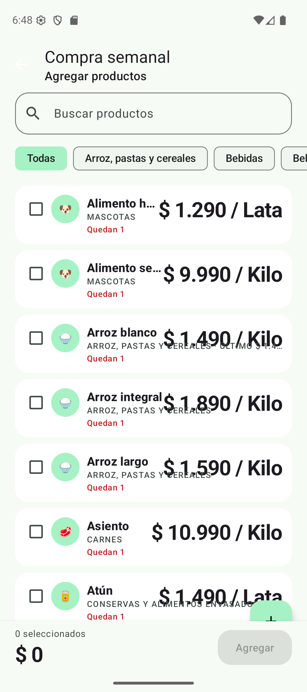

### Productos

- Catálogo con nombre, categoría, unidad de medida, cantidad habitual, stock, precio estimado y
  estado activo.
- Más de 25 categorías de supermercado (alimentos, bebidas, panadería, lácteos, mascotas, limpieza,
  higiene, congelados, etc.), con filtro por categoría, favoritos y búsqueda.
- Historial de precios por producto: precio promedio, mínimo, máximo, último precio, cantidad de
  compras y frecuencia.

| Catálogo | Editor de producto |
| --- | --- |
| 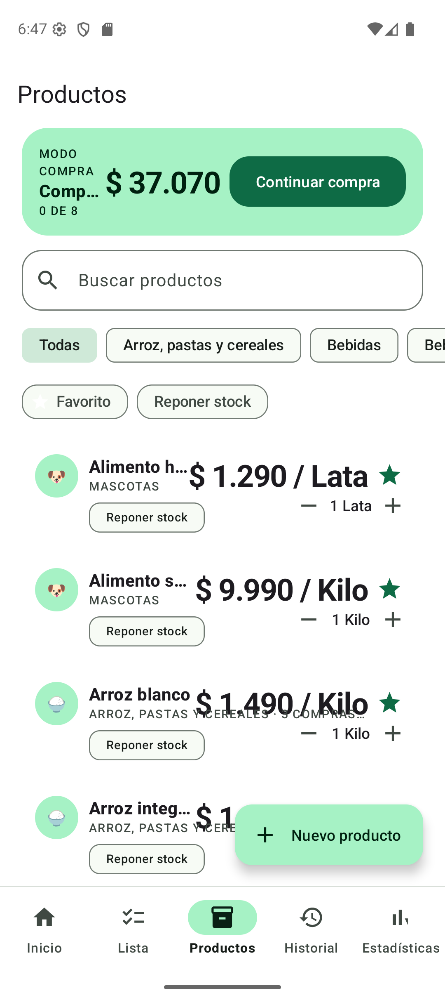 | 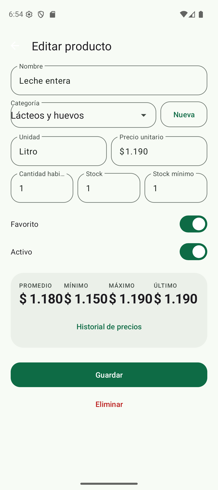 |

Evolución del precio de un producto en cada compra:

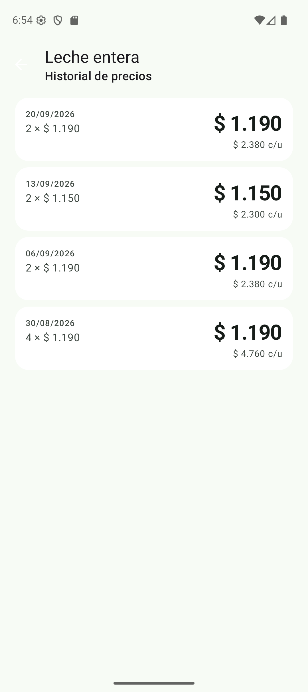

### Modo supermercado (`SupermarketActivity`)

Pantalla de registro rápido, pensada para usarse con una mano en el supermercado:

- Teclado numérico automático al ingresar el precio.
- Precio real, descuento y precio final calculado en vivo.
- Avance automático al siguiente producto pendiente.
- Marcado de productos como *No encontré*, con motivo (sin stock, no disponible, cambié de opinión,
  otro) y registro de un producto sustituto.

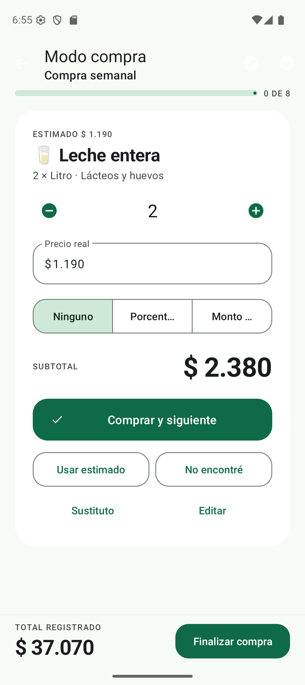

Al finalizar se pide confirmación antes de guardar la compra en el historial:

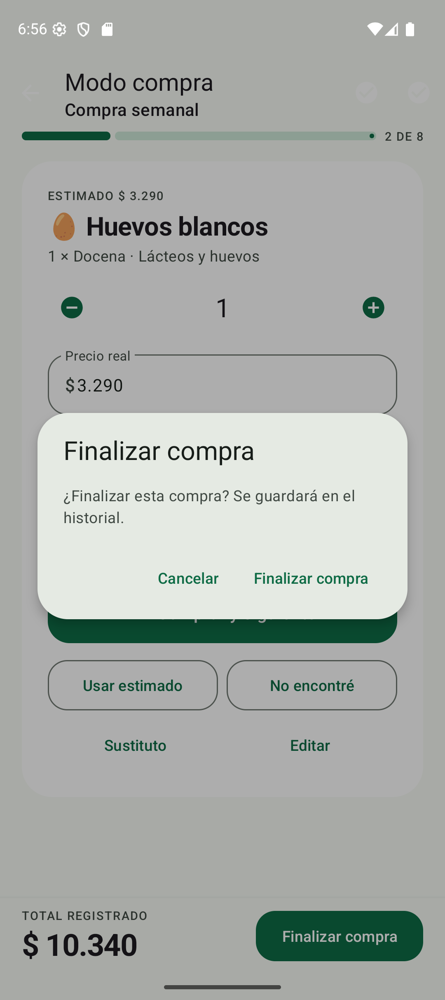

### Historial

Compras completadas agrupadas por mes, con total real, número de productos y porcentaje de
diferencia respecto de la compra anterior. Permite abrir el detalle de cada compra.

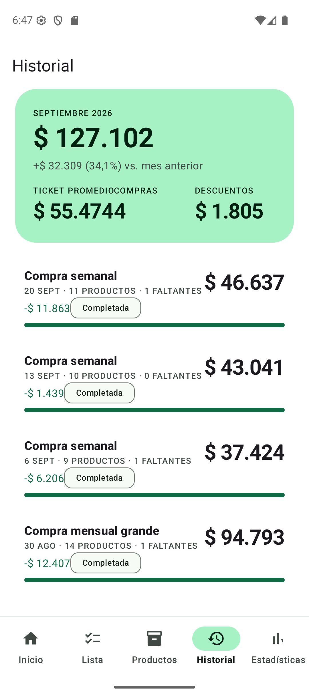

El detalle muestra el estimado, lo realmente pagado y la diferencia por ítem, con los precios reales
registrados en el supermercado:

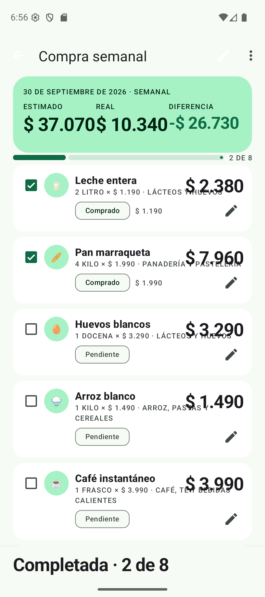

### Estadísticas

- Gasto mensual y total acumulado.
- Gráfico de gasto semanal.
- Productos más comprados y productos con mayor gasto.
- Descuentos obtenidos y comparación entre compras.
- Resumen de productos no encontrados.

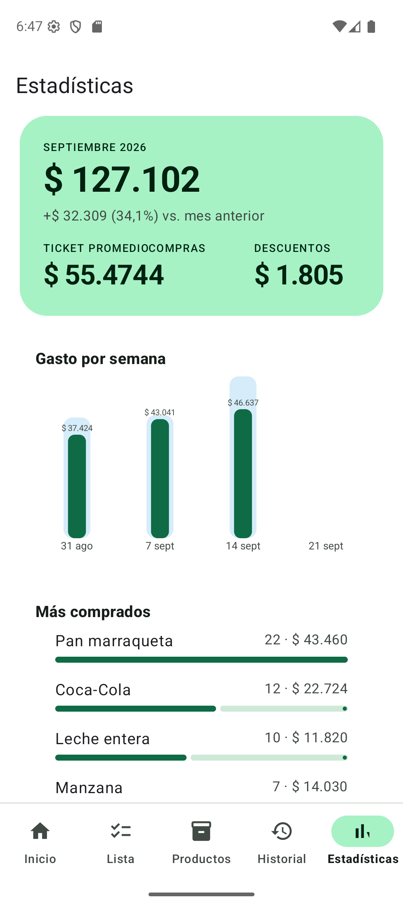

## Flujo principal

```text
Inicio
   ↓
Nueva lista de compra
   ↓
Agregar productos
   ↓
Definir cantidades y precios estimados
   ↓
Ver total estimado
   ↓
Ir al supermercado
   ↓
Registrar precio real
   ↓
Aplicar descuento
   ↓
Confirmar producto
   ↓
Finalizar compra
   ↓
Guardar historial
   ↓
Analizar estadísticas
```

## Arquitectura

```text
UI (Activities / Fragments / Adapters)
   ↓  LiveData
ViewModel
   ↓
Repository  ──  DataGraph (contenedor de dependencias)
   ↓
DAO (Room)
   ↓
SQLite (mis_compras.db)
```

La lógica de negocio vive en los `Repository` y en `domain/`, nunca en las Activities.
`DataGraph` es el punto único de acceso a los repositorios, con inicialización perezosa y
double-checked locking.

## Estructura del proyecto

```text
app/src/main/java/com/example/miscompras/
├── MainActivity.java              # Shell con Bottom Navigation (5 secciones)
├── data/
│   ├── DataGraph.java             # Contenedor de dependencias
│   ├── DataExecutors.java         # Hilos de base de datos y callbacks en el main thread
│   ├── local/
│   │   ├── AppDatabase.java       # Room, versión 1, exportSchema = true
│   │   ├── Converters.java        # TypeConverters de enums
│   │   ├── Seed.java              # Datos iniciales de ejemplo
│   │   ├── entity/                # Category, Product, ShoppingList, ShoppingListItem,
│   │   │                          # PriceHistory, PurchaseHistory
│   │   ├── dao/                   # CategoryDao, ProductDao, ShoppingListDao,
│   │   │                          # ShoppingListItemDao, PriceHistoryDao, StatsDao
│   │   └── model/                 # Proyecciones de consultas (ItemRow, ListSummary,
│   │                              #  ProductStat, ProductPriceStats, MonthTotal, ...)
│   ├── model/StatsSnapshot.java   # Objeto inmutable de estadísticas
│   └── repository/                # ProductRepository, ShoppingRepository, StatsRepository
├── domain/
│   ├── ListType.java              # WEEKLY, BIWEEKLY, MONTHLY, OTHER
│   ├── ListStatus.java            # PLANNED, IN_PROGRESS, COMPLETED, CANCELLED
│   ├── DiscountType.java          # NONE, PERCENT, FIXED
│   ├── ItemStatus.java            # PENDING, PURCHASED, NOT_FOUND (derivado del ítem)
│   ├── NotFoundReason.java        # OUT_OF_STOCK, NOT_AVAILABLE, CHANGED_MIND, OTHER
│   └── Pricing.java               # Cálculo de descuentos y totales
├── ui/
│   ├── common/                    # SystemBars (edge-to-edge), Ui (helpers)
│   ├── onboarding/                # OnboardingActivity + OnboardingAdapter (bienvenida,
│   │                              #  introduction y elección de idioma y moneda)
│   ├── dashboard/                 # DashboardFragment + ViewModel
│   ├── lists/                     # ListsFragment + ViewModel + ListsAdapter
│   ├── newlist/                   # NewListActivity
│   ├── addproducts/               # AddProductsActivity + ViewModel + ProductPickerAdapter
│   ├── listdetail/                # ListDetailActivity + ViewModel, ListItemsAdapter,
│   │                              # ItemEditSheet, EditListDialog, FinishSummarySheet
│   ├── shopping/                  # SupermarketActivity + ViewModel
│   ├── products/                  # ProductsFragment, ProductEditActivity, PriceHistoryActivity
│   ├── history/                   # HistoryFragment + ViewModel + HistoryAdapter
│   └── stats/                     # StatsFragment + ViewModel + WeekChartView
└── utils/                         # AppPreferences, Dates, Money, Validators
```

Recursos:

```text
app/src/main/res/
├── layout/     # 30 layouts (pantallas, items, bottom sheets, diálogos)
├── menu/       # Menús de las Activities
├── values/     # strings, colors, themes, dimens (español)
├── values-night/  # Colores y tema oscuro
├── color/, drawable/, mipmap-*/
└── xml/        # backup_rules.xml, data_extraction_rules.xml
```

## Base de datos

Base: `mis_compras.db`, versión `1`, con `exportSchema = true` (los esquemas se exportan a
`app/schemas/`). Las migraciones usan `fallbackToDestructiveMigration()`.

```text
Category
   │
   └── Product
          ├── PriceHistory
          └── ShoppingListItem
                     │
                     └── ShoppingList
                            └── PurchaseHistory
```

| Entidad | Contenido |
| --- | --- |
| `Category` | id, name |
| `Product` | name, categoryId, unit, estimatedPrice, currentStock, minimumStock, usualQuantity, isFavorite, isActive |
| `ShoppingList` | name, type, status, plannedDate, completedDate, estimatedTotal, realTotal, totalDiscount |
| `ShoppingListItem` | productId, quantity, estimatedUnitPrice, realUnitPrice, discountType, discountValue, finalUnitPrice, estimatedSubtotal, realSubtotal, isPurchased, notFound, notFoundReason, substituteProductId, position |
| `PriceHistory` | productId, shoppingListId, price, discount, finalPrice, date |
| `PurchaseHistory` | shoppingListId, purchaseDate, total, discount |

En la primera apertura, `Seed` inserta categorías y productos de ejemplo para que la aplicación
sea utilizable de inmediato.

## Reglas de negocio y validaciones

- `cantidad × precio = subtotal`, calculado siempre automáticamente.
- El precio final nunca puede ser negativo.
- Descuento por porcentaje (0–100 %) o por monto fijo.
- Cantidades y precios no negativos; descuento porcentual máximo 100 %.
- Un producto no puede repetirse dentro de la misma lista.
- Se pide confirmación antes de eliminar productos, cancelar listas y finalizar compras.
- Total estimado, total real, descuentos y diferencia se recalculan en cada cambio de estado.

## Dependencias

Definidas en `gradle/libs.versions.toml`:

| Librería | Versión |
| --- | --- |
| `androidx.appcompat` | 1.8.0 |
| `com.google.android.material` | 1.14.0 |
| `androidx.activity` | 1.13.0 |
| `androidx.fragment` | 1.8.9 |
| `androidx.constraintlayout` | 2.2.2 |
| `androidx.core` | 1.16.0 |
| `androidx.recyclerview` | 1.4.0 |
| `androidx.room` | 2.7.1 (`annotationProcessor`, no KSP) |
| `androidx.lifecycle` | 2.9.4 |

## Notas técnicas

- El proyecto es **Java puro**: Room se procesa con `annotationProcessor`, no con KSP.
- Con AGP 9 los `R.id` ya no son constantes de compilación, por lo que la navegación de
  `MainActivity` usa `if/else` en lugar de `switch` sobre `item.getItemId()`.
- `MainActivity.EXTRA_TAB` permite abrir una sección concreta desde otra pantalla
  (por ejemplo, el historial desde el detalle de una lista).
- Interfaz en español, con tema claro y oscuro y soporte de edge-to-edge mediante
  `SystemBars.pad(...)`.
- `Money` centraliza el formato según la moneda elegida en el asistente: separador de miles `.`,
  decimal `,` y el signo negativo delante del símbolo (`-$ 45.900`). Los importes largos se
  ajustan solos de tamaño (`Widget.MisCompras.Amount.Fit*`) y el gráfico semanal los abrevia
  (`$ 1,2 M`) para que nunca se corten.
- Todo monto que el usuario escribe o edita se interpreta con el formato local
  (`Validators.parseMoney`), de modo que `1.190` se lee como mil ciento noventa.
- La lógica de sugerencias y comparación de compras es determinista, basada en reglas; no hay IA.
  La estructura está preparada para incorporarla en el futuro.

## Estado del proyecto

Fases 1 y 2 del plan completas: catálogo de productos, creación y gestión de listas, modo
supermercado con descuentos y sustitutos, historial, historial de precios y estadísticas.
La FASE 3 (compras recurrentes, predicción y recomendaciones) queda planteada pero no
implementada.

Requisitos funcionales completos en [`funcionalidades.md`](funcionalidades.md).
